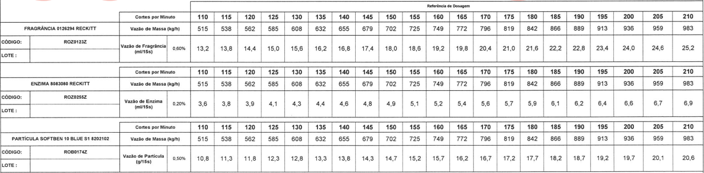

<!--
GitHub Profile README
Before publishing:
1. Replace every YOUR_USERNAME with your GitHub username.
2. Replace placeholder project links with your real repositories.
3. Remove any technologies or claims that do not represent your experience.
-->

  

<h1 align="center">Hi there, I'm an Engineer 👋</h1>

    

  
  
  

---

## 🇬🇧 About Me

I'm an engineer interested in connecting **engineering, data, and technology** to solve real-world problems.

I enjoy exploring ways to improve industrial processes, monitor performance indicators, reduce losses, automate repetitive tasks, and turn raw data into actionable insights.

This profile is my space to document projects, experiment with new technologies, and share my continuous learning journey.

### What I'm interested in

- 🏭 **Production Engineering:** process optimization, productivity, OEE, KPIs, and loss reduction.
- 📊 **Data Analysis:** dashboards, data visualization, Excel, and performance monitoring.
- 🐍 **Programming:** Python, data processing, and practical engineering tools.
- 🤖 **Automation & AI:** workflow automation, AI-assisted analysis, and intelligent agents.
- 🎓 **Personal & Academic Projects:** applying engineering concepts to practical challenges.

## 🇧🇷 Sobre mim

Sou engenheiro e tenho interesse em conectar **engenharia, dados e tecnologia** para resolver problemas reais.

Gosto de explorar maneiras de melhorar processos industriais, acompanhar indicadores de desempenho, reduzir perdas, automatizar tarefas repetitivas e transformar dados brutos em informações úteis para a tomada de decisão.

Este perfil é meu espaço para documentar projetos, experimentar novas tecnologias e compartilhar minha jornada de aprendizado contínuo.

### Áreas de interesse

- 🏭 **Engenharia de Produção:** otimização de processos, produtividade, OEE, indicadores e redução de perdas.
- 📊 **Análise de Dados:** dashboards, visualização de dados, Excel e monitoramento de desempenho.
- 🐍 **Programação:** Python, tratamento de dados e ferramentas aplicadas à engenharia.
- 🤖 **Automação e IA:** automação de fluxos de trabalho, análise assistida por IA e agentes inteligentes.
- 🎓 **Projetos pessoais e acadêmicos:** aplicação de conceitos de engenharia em desafios práticos.

---

## 🛠️ Technologies & Tools | Tecnologias e ferramentas

  

  
  
  
  

> **Note / Observação:** These badges represent areas of interest, not a claim of proficiency in every tool. Update this section as your skills and projects evolve. / Estes emblemas representam áreas de interesse, não uma afirmação de domínio de todas as ferramentas. Atualize esta seção conforme suas habilidades evoluírem.

---

## 🚀 Featured Projects | Projetos em destaque

Here are some project ideas and portfolio areas I'm interested in developing. Replace these examples with links to your actual repositories as you publish your work.

Estes são exemplos de projetos e áreas que pretendo desenvolver. Substitua os exemplos pelos links dos seus repositórios reais à medida que publicar seus trabalhos.

<table>
  <tr>
    <td width="50%" valign="top">
      
      <h3>🏭 Production Performance Dashboard</h3>
      
Dashboard concept for monitoring production KPIs, OEE, downtime, and operational losses.

      
<strong>Conceito de dashboard de produção</strong>

      
Painel para acompanhamento de indicadores, OEE, paradas e perdas operacionais.

      
<code>Excel</code> <code>Power BI</code> <code>Data Analysis</code>

      <a href="https://github.com/YOUR_USERNAME">View project / Ver projeto →</a>
    </td>
    <td width="50%" valign="top">
      
      <h3>📊 Industrial Loss Analysis</h3>
      
Analyze production losses, classify root causes, and identify improvement opportunities.

      
<strong>Análise de perdas industriais</strong>

      
Análise de perdas de produção, classificação de causas e identificação de melhorias.

      
<code>Python</code> <code>Pandas</code> <code>Visualization</code>

      <a href="https://github.com/YOUR_USERNAME">View project / Ver projeto →</a>
    </td>
  </tr>
  <tr>
    <td width="50%" valign="top">
      
      <h3>🤖 Automation & AI Tools</h3>
      
Small tools and intelligent workflows to automate repetitive tasks and support decision-making.

      
<strong>Ferramentas de automação e IA</strong>

      
Ferramentas e fluxos inteligentes para automatizar tarefas repetitivas e apoiar decisões.

      
<code>Python</code> <code>APIs</code> <code>AI</code>

      <a href="https://github.com/YOUR_USERNAME">View project / Ver projeto →</a>
    </td>
    <td width="50%" valign="top">
      
      <h3>🎓 Engineering Projects & Studies</h3>
      
Personal experiments, academic projects, engineering calculations, and programming exercises.

      
<strong>Projetos de engenharia e estudos</strong>

      
Experimentos pessoais, projetos acadêmicos, cálculos de engenharia e exercícios de programação.

      
<code>Engineering</code> <code>Python</code> <code>Learning</code>

      <a href="https://github.com/YOUR_USERNAME">View project / Ver projeto →</a>
    </td>
  </tr>
</table>

---

## 📈 GitHub Statistics | Estatísticas do GitHub

  
  

  

  

---

## 🎯 Goals | Objetivos

**🇬🇧 English**
- Build practical projects that connect engineering and programming.
- Develop stronger data analysis and visualization skills.
- Explore automation, AI tools, and intelligent agents.
- Share projects, learn from the community, and keep improving.

**🇧🇷 Português**
- Desenvolver projetos práticos que conectem engenharia e programação.
- Aprimorar habilidades de análise e visualização de dados.
- Explorar automação, ferramentas de IA e agentes inteligentes.
- Compartilhar projetos, aprender com a comunidade e evoluir continuamente.

---

## 🤝 Let's Connect | Vamos nos conectar

  
  

  <em>"Continuous improvement starts with curiosity, data, and action."</em>
   
  <em>"A melhoria contínua começa com curiosidade, dados e ação."</em>

  

